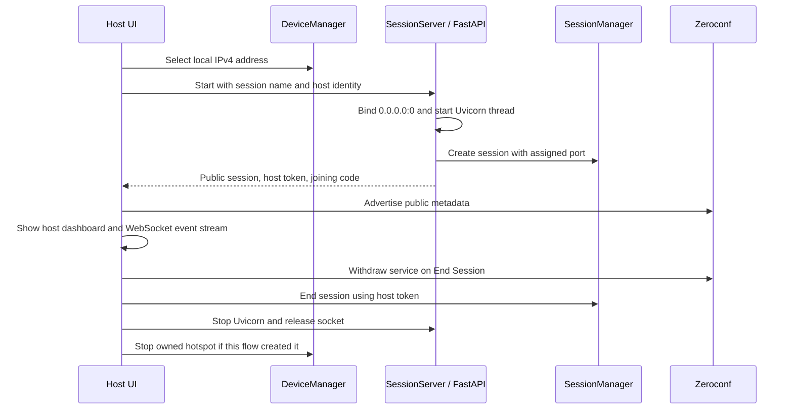
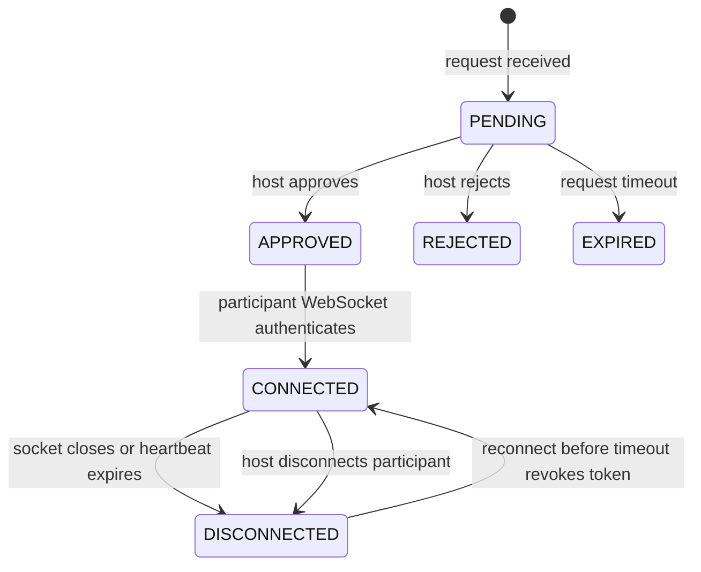

# ShareSpace architecture

Version 0.4.0 adds a local file-sharing layer above the Version 0.3 session layer and
Version 0.2 platform adapters.
The existing Windows and Linux hotspot implementations remain separate and are not
used by the session state machine. Hosting on an existing local network is also
supported so session work can be exercised when a platform cannot create a hotspot.

## Module boundaries

### Shared core

- `sharespace.core.models` contains validated public session, join request, participant,
  and state models shared by the API and UI.
- `sharespace.core.session_manager.SessionManager` owns one in-memory session. It
  creates IDs and credentials, validates join codes, records requests and participants,
  enforces host-only operations, handles heartbeats, and expires stale state. It has no
  Qt or network dependency.
- `sharespace.core.file_manager.SharedDirectoryManager` owns one host-selected root,
  accepts only relative protocol paths, filters hidden items, rejects symbolic links
  and Windows reparse points, and checks resolved paths stay inside the root.
- `sharespace.core.transfer_manager.TransferManager` tracks transfer byte counts,
  status, cancellation, and a bounded in-memory history. It stores no file content.
- `sharespace.core.device_manager.DeviceManager` reports the device name, OS, and usable
  local IPv4 addresses. It prefers the hotspot address when the user selected the
  existing hotspot workflow. It never chooses a globally routable address as the host
  address.

### Local networking

- `sharespace.networking.session_server.create_session_app` creates the FastAPI HTTP
  and WebSocket application. `SessionServer` binds a socket to `0.0.0.0` on port zero,
  starts Uvicorn in a background thread, and returns the actual selected port.
- `sharespace.networking.discovery.SessionAdvertiser` publishes the active session
  through Zeroconf/mDNS on `_sharespace._tcp.local.`. It refreshes metadata every 15
  seconds and sends a goodbye record on orderly shutdown. `SessionDiscovery` resolves,
  deduplicates, and expires service records after 180 seconds without an update.
- `sharespace.networking.session_client.SessionClient` provides asynchronous HTTP
  calls and an authenticated WebSocket event stream. Participant clients send a
  heartbeat every five seconds and reconnect after temporary transport failures.
- `sharespace.networking.session_server.EventBroker` fans out session events to
  connected WebSocket clients and allows one live WebSocket per participant identity.
- `sharespace.networking.file_service.FileService` attaches to each session server
  and owns root settings, upload state, temporary uploads, and streaming operations.
- `sharespace.networking.file_routes` adds authenticated browse, metadata, download,
  upload, transfer status, and cancellation routes to the FastAPI app.
- `sharespace.networking.file_client.FileClient` streams files and creates local
  downloads without replacing existing files.

### Qt presentation

- `HostSessionDialog` retains adapter detection, compatibility checks, and the
  Version 0.2 hotspot controls. It adds two entry paths: **Host on this network**, or
  **Host using this hotspot** after a hotspot has been created.
- `SessionHostDialog` displays the session ID, joining code, address and port, pending
  requests, and participant states. It performs approval, rejection, disconnect, and
  session teardown.
- `SessionJoinDialog` discovers sessions, supports a manual local IPv4 address and
  port, submits a join request, polls approval status, monitors the WebSocket, and
  opens the authenticated participant file browser when connected.
- `FileBrowserDialog` displays relative contents, downloads, optional uploads,
  transfer progress, and cancellation controls.
- `SessionHostDialog` selects or stops the shared root, controls uploads (off by
  default), and displays or cancels active transfers.
- `sharespace.ui.session_workers` runs blocking setup and asynchronous network work in
  Qt worker threads. The presentation thread handles only widget updates and cached
  discovery snapshots.

### Platform adapters

`sharespace.platform.base_hotspot`, `platform_manager`, `platform.windows`, and
`platform.linux` are unchanged by this milestone. They retain OS-specific hotspot
behavior behind the shared adapter interface. The Windows `wiFiControl` package
capability and connection-profile limitations documented for Version 0.2 remain in
force.

## Session startup and shutdown



The session ID is a random UUID. The joining code is a 12-character value selected
from an alphabet that omits visually ambiguous characters. The server port is
selected by the operating system; neither the code nor the session ID is used as a
network address. No host IP is hardcoded.

## State model



The host is a participant with role `HOST`; ordinary devices use `PARTICIPANT`.
Participant states are `PENDING`, `CONNECTED`, `DISCONNECTED`, and `REJECTED`. A
reconnect within the 25-second heartbeat timeout reuses the same participant ID while
its token remains valid. Once the heartbeat monitor expires the participant, its token is revoked and a
new request is required. Pending join requests expire after 180 seconds.

## HTTP API and authorization

All routes use the `/api/v1` prefix. Responses use JSON and Pydantic validation.
Validation errors omit submitted input values so a joining code is not echoed.

| Method and route | Purpose | Authorization |
| --- | --- | --- |
| `GET /api/v1/health` | Local server health | None |
| `GET /api/v1/session` | Public metadata for manual connection | None |
| `POST /api/v1/sessions/{session_id}/join-requests` | Validate code and request host approval | Joining code in request body |
| `GET /api/v1/join-requests/{request_id}` | Poll request status and retrieve approved participant token | Request bearer token |
| `GET /api/v1/host/snapshot` | Read requests and participants | Host bearer token |
| `POST /api/v1/host/join-requests/{request_id}/approve` | Approve one pending request | Host bearer token |
| `POST /api/v1/host/join-requests/{request_id}/reject` | Reject one pending request | Host bearer token |
| `POST /api/v1/host/participants/{participant_id}/disconnect` | Revoke a connected participant | Host bearer token |
| `POST /api/v1/host/end` | End the session | Host bearer token |
| `GET /api/v1/files/settings` | Read shared folder name and upload availability | Connected participant token |
| `GET /api/v1/files?path=...` | Browse one relative directory | Connected participant token |
| `GET /api/v1/files/info?path=...` | Read file metadata | Connected participant token |
| `GET /api/v1/files/download?path=...` | Stream one file up to 20,000,000 bytes | Connected participant token |
| `POST /api/v1/files/upload?path=...` | Stream a new file into a relative directory | Connected participant token; uploads enabled |
| `GET /api/v1/files/transfers` | Read this participant's transfer state | Connected participant token |
| `POST /api/v1/files/transfers/{transfer_id}/cancel` | Cancel this participant's transfer | Connected participant token |
| `GET /api/v1/host/files/state` | Read host-side sharing state | Host bearer token |
| `POST /api/v1/host/files/uploads` | Enable or disable uploads | Host bearer token |
| `GET /api/v1/host/files/transfers` | Read all session transfer states | Host bearer token |
| `POST /api/v1/host/files/transfers/{transfer_id}/cancel` | Cancel any transfer | Host bearer token |

Bearer tokens are sent in the HTTP `Authorization` header. The WebSocket endpoint is
`/api/v1/sessions/{session_id}/events`. After connecting, the client must send:

```json
{"type":"AUTHENTICATE","token":"<host-or-participant-token>"}
```

Participants then send `{"type":"HEARTBEAT"}` every five seconds. The server replies
with `{"type":"heartbeat_ack"}` and emits state events such as
`join_request_pending`, `join_request_approved`, `join_request_rejected`,
`participant_connected`, `participant_disconnected`, and `session_ended`. Unknown
WebSocket message types receive a structured error response.

## Discovery metadata

The mDNS service record contains protocol version, session ID and name, host device
name and OS, participant count, status, and creation time. Its service address records
carry local IPv4 addresses and the selected TCP port. It never includes a joining code,
host token, request token, participant token, or file information. Duplicate records
with the same session ID update one entry. A service goodbye removes an entry
immediately; crash or packet-loss cases age out within the discovery stale timeout.

Manual connection calls `GET /api/v1/session` at the entered local IPv4 address and
port, obtains the session ID, and still requires the joining code for access. The
desktop currently accepts private, link-local, or loopback IPv4 manual targets and
does not accept globally routable addresses.

## Security and limits

- Session IDs use UUID4. Joining codes and bearer tokens use Python's `secrets` module.
- The joining code is stored as a salted PBKDF2-HMAC-SHA256 digest in memory. Failed
  join-code checks are rate-limited to 20 per source address per minute.
- The session manager stores the host, request, and participant authentication digests.
  It temporarily retains an approved participant token in that join request so the
  requester can retrieve it by polling with its request token. Credentials remain in
  memory only and are cleared when the session ends or a participant is revoked.
- Only the host token can approve or reject requests, disconnect participants, or end
  a session. The server rejects a second simultaneous WebSocket for the same
  participant identity.
- The server disables access logs, and validation errors do not return request bodies.
  The app stores active state only in memory and does not write joining codes to logs.
- File requests require an approved, currently connected participant token. Host
  settings and transfer controls require the host token. The shared absolute path is
  exposed only to the host UI; participant responses use relative paths and the shared
  directory name.
- Symbolic links and reparse points are not followed. Hidden entries are not listed or
  served. Uploads use a same-directory temporary file, enforce declared and actual
  sizes, and atomically create a destination only if its name is still unused.
- Each file is limited to 20,000,000 bytes. Uploads are disabled at session start.
  Transfer history is bounded and held only in memory. The file service does not
  modify or delete existing shared files.
- HTTP and WebSocket traffic are **not encrypted** in Version 0.4.0. Devices sharing
  an untrusted local network may be able to observe traffic. TLS, stronger peer
  identity, and broader security review are future work.
- mDNS may be blocked by host firewalls, access-point client isolation, VLANs, or
  multicast settings. Manual connection still depends on local TCP reachability.
- The OS firewall may block the randomly selected server port. The UI displays the
  port; allow the ShareSpace Python app on a trusted private network when prompted.
- A ShareSpace-created hotspot is not assumed to permit client-to-client traffic.
  Windows hotspot creation remains unavailable in this unpackaged development build;
  Linux hotspot behavior remains hardware-unverified.
- An orderly End Session sends a final event and withdraws mDNS. If the host process
  crashes or loses power, it cannot send either message; clients detect the closed
  transport and the discovery entry expires after its TTL/stale timeout. OS hotspot
  cleanup after a process crash remains subject to the Version 0.2 adapter limitations.

File transfers stream in 64 KiB chunks. Uploads use a raw octet stream rather than
multipart form parsing, so no separate multipart dependency is required. The host
selects the shared root locally; session discovery metadata never advertises the folder
path or file contents.
