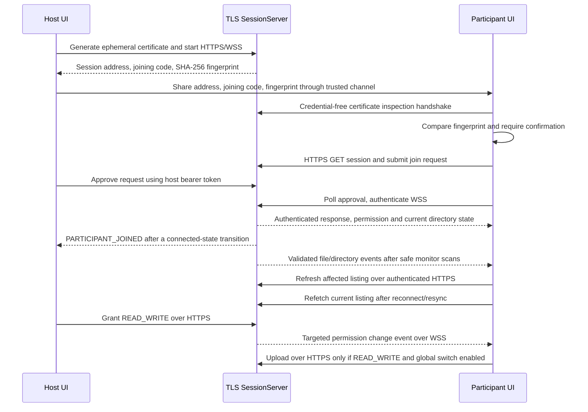

# ShareSpace architecture

Version 1.0.0 packages the existing local networking, session management, permissions,
file transfers, live updates, local history, and settings as native Windows and Linux
applications. It adds startup diagnostics, safe database migration hooks, and
per-user installation without changing the shared application logic or merging the
platform-specific hotspot adapters. Runtime functionality remains local and
offline-first.

## Module boundaries

### Shared core

- `sharespace.core.models` defines validated session, participant, permission,
  directory, and transfer models shared by the API and UI.
- `sharespace.core.session_manager.SessionManager` owns in-memory session state,
  credentials, join approval, participant identity, heartbeats, and permissions. Each
  approved participant starts as `READ_ONLY`. It is the authority for role, active
  connection, and permission; the client never supplies these values.
- `sharespace.core.file_manager.SharedDirectoryManager` owns the host-selected root,
  relative-path validation, hidden-item filtering, symlink/reparse rejection, and
  confinement checks. Its `root_available()` check also detects a removed or
  replaced selected root. Tree search traverses only this root, returns safe relative
  metadata, and never reads file contents.
- `sharespace.core.file_monitor.FileMonitor` owns one watchdog observer and one
  bounded event worker. It schedules non-recursive watches for directories that the
  manager lists as permitted, then derives public file changes from safe directory
  snapshots. It never reads contents or publishes absolute paths. A short quiet
  interval (250 ms by default) coalesces bursts. Ordinary file changes rescan only
  affected parent directories; directory topology changes and queue overflow use a
  full safe scan. Inaccessible subtrees retain their previous snapshot until access
  returns. Queue overflow produces a resync hint.
- `sharespace.core.transfer_manager.TransferManager` remains authoritative for active
  transfer state, byte counts, cancellation, and bounded in-memory views. Lifecycle
  snapshots are sent to local history storage without storing file contents.
- `sharespace.core.device_manager.DeviceManager` identifies the device and available
  local IPv4 addresses and selects the host address without hardcoding it.

### Local application storage

- `sharespace.storage.local_store.LocalStore` owns one thread-safe SQLite connection
  for settings, transfer history, and session history. It uses Python's standard
  `sqlite3`, parameterized statements, transactions, a schema version, and Qt's
  platform-specific `AppLocalDataLocation`. The database is outside any shared root.
- The `settings` table stores JSON values for theme, notification preferences,
  download destination, and history retention. No session credentials or network
  security settings are stored there.
- `transfer_history` stores transfer IDs, filename, direction, size, transferred
  bytes, status, timestamps, a sanitized error summary, and a participant identifier
  when relevant. The ID is the primary key, so repeated lifecycle snapshots update
  one row. Active snapshots are written at start and at 1 MiB progress intervals;
  terminal states are written after the transfer manager decides the outcome.
- `session_history` stores the local role, session name/ID, host device, timestamps,
  duration, participant count, and final outcome. A row starts as local `ACTIVE` while
  the live session is running; history views exclude that state. On application
  startup, unfinished transfer and session rows are finalized as `INTERRUPTED`.
- Startup applies the selected retention period (30, 90, or 365 days, or unlimited)
  only to terminal history. Manual clearing also preserves active state and never
  removes shared files. Database errors are logged and surfaced; if persistent storage
  cannot be opened, the application can continue with an in-memory fallback.

### Release packaging

- `sharespace.__version__` is the single source for package metadata, the window title,
  API metadata, Windows file properties, and archive names.
- `sharespace.ui.resources.resource_path` resolves icons from the source tree or
  PyInstaller's bundle directory without relying on the current working directory.
- `packaging/build_release.py` creates a native one-directory PyInstaller bundle,
  runs an isolated startup smoke test, exercises install/upgrade/uninstall, checks the
  payload for local data and key material, writes third-party notices, and generates
  an archive with a SHA-256 checksum.
- Windows and Linux installer scripts use per-user locations and a ShareSpace marker
  before replacing/removing installed files. They preserve application data on
  uninstall. Windows hotspot creation is unavailable in this classic package because
  the OS API requires package identity/capabilities.
- `.github/workflows/release-build.yml` builds on native Windows and Ubuntu runners
  and retains candidate archives as workflow artifacts. It does not publish a public
  release.

### Local networking

- `sharespace.networking.tls_security.SessionCertificateManager` creates one
  ephemeral self-signed RSA certificate and private key per host session. IP SANs
  cover all supplied local addresses and loopback addresses. The SHA-256 fingerprint
  is attached to public session metadata. Temporary key files are removed when the
  server stops. POSIX permissions are set to `0600` for files and `0700` for the
  directory; Windows uses the inherited access-control list of its temporary folder.
- `TLSConnectionSecurity` first inspects the peer certificate without sending HTTP,
  WebSocket data, or credentials. It compares the DER certificate's SHA-256 hash to
  the expected fingerprint, then creates a strict TLS context that requires the
  pinned certificate, validates its lifetime, and checks the host IP against the
  certificate SAN. TLS 1.2 is the minimum. There is no HTTP/WSS plaintext fallback.
- `sharespace.networking.session_server.SessionServer` binds a local socket and starts
  Uvicorn with the session certificate and key. HTTPS hosts the REST endpoints and
  WSS hosts the event endpoint. Startup and shutdown clean up the key material.
- `sharespace.networking.session_client.SessionClient` reuses a thread-safe HTTPX
  connection pool for HTTPS API requests and uses the same pin for WSS, approval,
  host controls, heartbeat events, and file-service control requests.
  The live event client distinguishes TLS verification from WebSocket setup and
  authentication, retries with delays capped at ten seconds, and stops after twelve
  consecutive failed attempts.
- `sharespace.networking.discovery.SessionAdvertiser` publishes public metadata on
  `_sharespace._tcp.local.` using protocol version 2. Discovery includes the
  fingerprint so the participant can compare it, but mDNS is not an independent
  trusted channel.
- `sharespace.networking.file_routes` authenticates every file operation. Browsing,
  metadata, and download require a currently connected participant. Upload additionally
  requires `READ_WRITE` and the host's global upload switch. Search uses the same
  connected-participant authentication and shared-root checks.
- `sharespace.networking.file_service.FileService` streams 64 KiB chunks. Its async
  authorization gate serializes permission changes, host upload toggles, participant
  disconnects, root changes, chunk writes, and final file publication. It cancels
  active uploads when access is revoked and removes incomplete temporary files.
- `sharespace.networking.websocket_events` validates one event envelope and the
  payload for each event type. `EventBroker` reuses authenticated WSS clients,
  filters targeted permission events, isolates per-client queues, and replaces an
  overfull queue with `SESSION_RESYNC_REQUIRED`. Event history is not persisted.
- `sharespace.networking.file_event_coordinator.FileEventCoordinator` owns the
  session monitor, restarts it on authorized root changes, marshals monitor-thread
  callbacks onto asyncio, and stops it on sharing/session shutdown. The monitor is
  the only file-event source: an upload is reported after FileService's atomic
  publication is visible in a manager listing, with no synthetic upload event.
- `sharespace.networking.file_client.FileClient` verifies the pinned certificate for
  file operations, streams without loading whole files into memory, and creates local
  download files without overwriting an existing destination. Search and transfer
  network calls are used from Qt worker threads.

### Qt presentation

- `HostSessionDialog` preserves the existing hotspot and network choices.
- `SessionHostDialog` shows the security status, negotiated TLS version, session
  fingerprint, requests, participant roles/status/permission, global upload setting,
  and transfer state. A health line reports server/session state, connected peers,
  shared-root availability, file-monitor status, event streams, and active transfers.
  The host can copy the fingerprint, grant/revoke `READ_WRITE`, disconnect
  participants, and stop sharing. Its activity line and notifications update on file
  and participant events.
- `SessionJoinDialog` shows the expected fingerprint. It requires the participant to
  affirm an independent trusted-channel comparison before verification and before the
  joining code is sent. TLS errors and replacement fingerprints are surfaced to the
  participant.
- `FileBrowserDialog` keeps browsing and downloading available to `READ_ONLY`
  participants. Upload controls require both `READ_WRITE` and the globally enabled
  upload state. It has debounced, background tree search, breadcrumb and parent
  navigation, result-location navigation, sorting, metadata formatting, empty/loading
  states, a three-transfer UI limit, and a default local download destination. File
  and directory events refresh the current listing or matching search results through
  the authenticated API; reconnect and resync hints recover the server-owned listing.
- `HistoryDialog` shows local transfer or session metadata with filters and sorting.
  It never turns an old session into an active or joinable session. `SettingsDialog`
  edits local theme, notification, destination, and retention preferences.
- `sharespace.ui.error_messages` maps common network, filesystem, TLS, storage, and
  transfer errors to concise messages and removes local paths and credentials from
  generic error text. Background workers log diagnostic exceptions and emit a safe
  user-facing message.
- `sharespace.ui.notification_manager.NotificationManager` requests a Qt system-tray
  notification when available and otherwise shows a short in-app banner. Native
  delivery depends on the platform and user notification settings; automated checks
  mock this boundary.
- `sharespace.ui.session_workers` runs blocking setup and network work away from the
  Qt presentation thread. The filesystem observer and its snapshot worker also run
  outside the Qt presentation thread; callbacks enter asyncio with
  `run_coroutine_threadsafe`, and UI updates arrive through Qt signals.

The Windows and Linux hotspot implementations remain in their platform-specific
modules. TLS, session logic, file services, and permissions are shared.
Watchdog selects its platform observer behind the shared `FileMonitor` API. Automated
filesystem integration was run on Windows in this workspace; Linux watcher behavior
has not been run here.

## Session, permission, and trust flow

### Local metadata lifecycle

`SessionServer` writes a host session record only after Uvicorn reports ready; the
participant UI writes a joined-session record only after the WSS authentication
response. Session shutdown, a participant disconnect, a failed join/start, or startup
recovery finalizes the relevant local record. Failed attempts can be shown as `FAILED`
but never as completed live sessions.

The existing `TransferManager` controls each transfer. A client-side download is marked
complete only after the no-overwrite destination finalization succeeds. A host upload
is marked complete only after the service atomically publishes the file. Failed and
cancelled states are recorded separately; app startup marks any still-active persisted
transfer `INTERRUPTED` and does not restart it.

### File search

`GET /api/v1/files/search?q=...&limit=...` scans filenames and folder names inside the
selected shared root. The authenticated route offloads the scan from the ASGI event
loop. The scanner skips hidden entries, symlinks, Windows reparse points, temporary
upload files, and non-regular items. It returns at most 500 metadata records per
request (the UI asks for 200) and marks truncated results. Names are case-folded for
matching. No content index, file read, absolute path, or participant-supplied path
resolution is involved.

The joining code is a 12-character secret; host, request, and participant credentials
are generated with `secrets`. The joining code is stored as a salted PBKDF2-HMAC-SHA256
digest in memory and failed code attempts are rate-limited. Approved participant
tokens are temporarily available only through the matching request token. Disconnect
and session-end operations revoke credentials. Active state is not persisted.

## Participant permissions and upload evaluation

The host is reported separately with role `HOST` and no participant permission.
Ordinary approved participants have one of:

| Permission | Browse, view metadata, download | Upload new files |
| --- | --- | --- |
| `READ_ONLY` | Allowed while connected | Rejected |
| `READ_WRITE` | Allowed while connected | Allowed only while host uploads are enabled |

`READ_WRITE` permits only a new upload. It does not add file modification, deletion,
rename, or directory creation operations. Host-only settings and participant
management remain restricted to the host token. Transfer queries and cancellation
remain scoped to the authenticated participant; the host may view/cancel any session
transfer.

For each upload, the server evaluates the conditions in this order:

1. Validate the bearer token, active session, participant identity, and connected state.
2. Require `READ_WRITE` participant permission.
3. Require the host's global uploads setting and a selected root.
4. Validate filename, declared size, destination path, and no-overwrite rules.
5. Recheck participant permission and the global setting under the authorization gate
   before creating the temporary file, before each chunk write, and before atomically
   publishing the final file.

The host's permission route updates the server-owned permission while holding the
same gate used by upload writes and commit. On `READ_WRITE` to `READ_ONLY`, active
uploads are cancelled, their `.part` files are deleted, and a targeted
`participant_permission_changed` event updates the participant UI. If an event is
missed, the next API request still uses the new server permission. A host disconnect
or session shutdown cancels that participant's active transfers.

## HTTP API and authorization

Routes use the `/api/v1` prefix and structured JSON errors. Session request validation
does not echo submitted values such as join codes. Access and transport are separate:
all application API and event communication runs over HTTPS/WSS using the pinned
session certificate.

| Method and route | Purpose | Authorization |
| --- | --- | --- |
| `GET /api/v1/health` | Local server health | None; HTTPS only in production session server |
| `GET /api/v1/session` | Public session metadata and fingerprint | None; HTTPS only in production session server |
| `POST /api/v1/sessions/{session_id}/join-requests` | Validate code and request approval | Joining code in body, HTTPS |
| `GET /api/v1/join-requests/{request_id}` | Poll and retrieve approved token | Request bearer token, HTTPS |
| `GET /api/v1/host/snapshot` | Read requests and participants | Host bearer token, HTTPS |
| `POST /api/v1/host/join-requests/{request_id}/approve` | Approve request | Host bearer token, HTTPS |
| `POST /api/v1/host/join-requests/{request_id}/reject` | Reject request | Host bearer token, HTTPS |
| `POST /api/v1/host/participants/{participant_id}/permissions` | Change participant permission | Host bearer token, HTTPS |
| `POST /api/v1/host/participants/{participant_id}/disconnect` | Revoke participant access | Host bearer token, HTTPS |
| `POST /api/v1/host/end` | End session | Host bearer token, HTTPS |
| `GET /api/v1/host/files/state` | Read host file-sharing state | Host bearer token, HTTPS |
| `POST /api/v1/host/files/root` | Select the shared root | Host bearer token, HTTPS |
| `POST /api/v1/host/files/stop` | Stop sharing the selected root | Host bearer token, HTTPS |
| `POST /api/v1/host/files/uploads` | Enable or disable global uploads | Host bearer token, HTTPS |
| `GET /api/v1/host/files/transfers` | Read all session transfer states | Host bearer token, HTTPS |
| `POST /api/v1/host/files/transfers/{transfer_id}/cancel` | Cancel any transfer | Host bearer token, HTTPS |
| `GET /api/v1/files/settings` | Read shared folder name and permission | Connected participant token, HTTPS |
| `GET /api/v1/files?path=...` | Browse relative directory | Connected participant token, HTTPS |
| `GET /api/v1/files/search?q=...&limit=...` | Search visible filenames and folders under the shared root | Connected participant token, HTTPS |
| `GET /api/v1/files/info?path=...` | Read file metadata | Connected participant token, HTTPS |
| `GET /api/v1/files/download?path=...` | Download a file up to 20 MB | Connected participant token, HTTPS |
| `POST /api/v1/files/upload?path=...` | Upload a new file | Connected token, `READ_WRITE`, global uploads enabled, HTTPS |
| `GET /api/v1/files/transfers` | Read participant transfer state | Connected participant token, HTTPS |
| `POST /api/v1/files/transfers/{transfer_id}/cancel` | Cancel own transfer | Connected participant token, HTTPS |

The WSS endpoint is `/api/v1/sessions/{session_id}/events`. The first message
authenticates with a bearer token after TLS is established. Participants send a
heartbeat every five seconds. Each event has `event_id`, `event_type`, a timezone-aware
ISO-8601 `timestamp`, and validated `data`; a legacy `type` and flat payload fields
remain for v0.5 UI compatibility. File events contain relative path, filename,
parent directory, and optional size/modified time only. Participant activity events
contain participant ID, device name, operating system, and count. Permission changes
are sent only to the affected participant. File-sharing state events contain
availability, global upload status, and the shared-directory display name. Events
never include joining codes, bearer tokens, private keys, file contents, or absolute
host filesystem paths.

The first and each recovered listing comes from the authenticated HTTP file API; WSS
events are update hints and do not authorize file access. The host's current directory
contents remain authoritative. WebSocket queues are bounded and event IDs are
deduplicated by clients, but there is no persistent event history. After reconnect or
queue overflow, clients retrieve the current listing instead of replaying missed
notifications. The filesystem worker uses manager path validation and excludes
hidden entries, symbolic links, reparse points, and known temporary names. Uploads
remain hidden under `.sharespace-*.part` while in progress and are observed only once
the existing no-overwrite atomic publication completes.

## Security boundaries and limitations

- The certificate is self-signed, ephemeral, and pinned for the active connection.
  Users must compare its fingerprint through an independent trusted channel. A value
  obtained only from the same local network or mDNS record does not protect against a
  network attacker who can replace both the record and certificate.
- TLS provides transport encryption and server identity after that fingerprint check.
  ShareSpace does not provide end-to-end encryption, public-key user identity, or
  protection after a trusted device is compromised.
- Private-key file mode is restrictive on POSIX. Windows uses the platform's
  temporary-directory ACL; this development build does not set a custom Windows ACL.
- Certificates are valid for 30 days but are removed with the session. There is no
  persistent trust store; clients must compare a new fingerprint for a new session.
- Active session state, authentication digests, and active transfer state remain in
  memory. User preferences and finalized/recoverable transfer and session metadata
  are stored locally in SQLite. The database contains no credentials, private keys,
  file contents, or absolute host shared-directory paths. The app disables Uvicorn
  access logs, logs authorization failure codes without request bodies, redacts
  common credential formats from application logs, and avoids logging credentials.
- Files are limited to 20,000,000 bytes, transferred in 64 KiB chunks. Uploads use a
  same-directory temporary file and atomic no-overwrite publication. Symbolic links
  and reparse points are not followed, hidden entries are not served, and the selected
  root is never changed by participant requests.
- mDNS and the randomly selected local port may be blocked by firewalls, VLANs,
  multicast settings, or client isolation. Hotspot behavior remains limited by the
  existing platform adapters. Physical Windows/Linux network behavior requires
  separate hardware testing.
- The watcher uses a 250 ms quiet interval and a 4,096-entry pending-event queue.
  No benchmark was run. A large directory move or overflow causes a recursive safe
  metadata scan; ordinary file changes inspect only their affected parent folders.
  Search performs a full metadata scan on demand after a 300 ms UI debounce; it runs
  outside the GUI and returns at most 200 rows by default. It may take longer on very
  large trees because no index is built. Actual OS tray notification delivery and
  Linux filesystem observer behavior need platform testing.
- The current automated and packaging results are recorded in
  `docs/networking-tests.md`. Windows workspace tests use Python 3.11 and the Qt
  offscreen plugin. Linux package behavior, physical cross-platform networking, and
  native notifications must be recorded separately from mocked or loopback results.

The implementation preserves the Version 0.4 file size limit and file operations.
Participants still cannot delete or rename files or create directories. File
synchronization, automatic transfer, persistent event/notification history, cloud
services, and end-to-end encryption remain outside Version 1.0.0.
